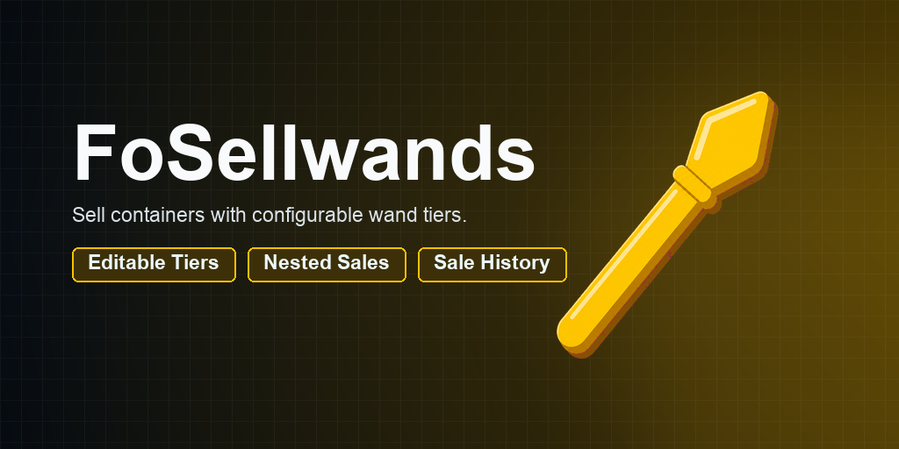
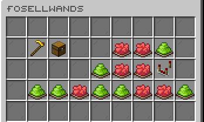
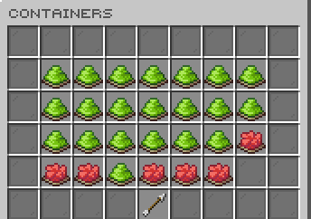

# FoSellwands

[](https://modrinth.com/plugin/fosellwands) [](https://modrinth.com/plugin/fosellwands/versions) [](https://discord.gg/kEF77QCfu7)

Editable sellwands for fast, protected container selling.

*Developed by Carrotio.*

## Features

- Creates editable sellwand tiers with multipliers and limited uses.
- Sells supported container contents through FoShop or ShopGUIPlus pricing.
- Supports cooldowns, permission controls, history, and sale breakdowns.
- Respects configured protection and WorldGuard rules.
- Includes AxSellwands migration and administrator give tools.

## Download and dependencies

Download the latest compatible version from [Modrinth](https://modrinth.com/plugin/fosellwands). Check the [versions page](https://modrinth.com/plugin/fosellwands/versions) for supported Minecraft versions and server platforms.

- **Required:** `Vault`
- **Optional integrations:** `FoShop`, `ShopGUIPlus`, `WorldGuard`

## Screenshots



*Manage sellwand settings.*



*Configure supported containers.*

## Support

For help or issue reports, join the [Carrotio Discord server](https://discord.gg/kEF77QCfu7).

<details>
<summary><strong>Commands and permissions</strong></summary>

### Commands

- `/fosellwandsadmin <editor|reload|version|list|give> [player] [multiplier|tier] [uses] [amount]` — FoSellwands admin command.

### Permissions

- `fosellwands.admin` — Allows managing FoSellwands. Default: `op`.
- `fosellwands.use` — Allows using sellwands. Default: `true`.
- `fosellwands.use.basic` — Allows using the basic sellwand tier when per-tier permissions are enabled. Default: `true`.
- `fosellwands.use.rare` — Allows using the rare sellwand tier when per-tier permissions are enabled. Default: `true`.
- `fosellwands.use.legendary` — Allows using the legendary sellwand tier when per-tier permissions are enabled. Default: `true`.

</details>

<details>
<summary><strong>PlaceholderAPI</strong></summary>

This plugin does not register public PlaceholderAPI placeholders.

</details>

<details>
<summary><strong>Configuration</strong></summary>

- `config.yml` — Main behavior and feature settings.
- `messages.yml` — Player-facing messages and interface text.
- `sounds.yml` — Configurable interaction sounds.
- `sellwands/*.yml` — Sellwand tier definitions.

Main config areas: `file-logging`, `settings`, `pricing`, `cooldown`, `permissions`, `breakdown`, `history`, `feedback`, `safety`, `protection`.

</details>

<details>
<summary><strong>Developer API</strong></summary>

These Java hooks are implemented in this checkout. Compile against a jar built from this source with Maven `provided` scope or Gradle `compileOnly`; do not shade FoSellwands into your plugin. The Maven coordinates below are from this project's `pom.xml`. Install the matching jar in your own Maven repository first; no public artifact repository is promised.

```xml
<dependency>
  <groupId>me.foesio</groupId>
  <artifactId>FoSellwands</artifactId>
  <version>1.8</version>
  <scope>provided</scope>
</dependency>
```

For a `plugin.yml` consumer, use `softdepend: [FoSellwands]` when the integration is optional, or `depend: [FoSellwands]` when it is required. Place direct FoSellwands class references in a separate integration class loaded only after checking that the provider plugin is present and enabled. For a Paper plugin, declare the server dependency and classpath access in `paper-plugin.yml` instead.

### Wand service

```java
RegisteredServiceProvider<SellwandApi> registration =
    Bukkit.getServicesManager().getRegistration(SellwandApi.class);
if (registration != null && registration.getPlugin().isEnabled()) {
    SellwandApi api = registration.getProvider();
    api.createTierWand("basic").ifPresent(wand -> player.getInventory().addItem(wand));
    api.readWand(player.getInventory().getItemInMainHand()).ifPresent(snapshot -> {
        int uses = snapshot.uses();
    });
}
```

The service is registered after FoSellwands initializes its required economy provider and is unregistered on disable. Reacquire it after a plugin reload; a cached instance throws `IllegalStateException` after FoSellwands disables. Call it on the relevant server tick thread; do not call it asynchronously or access another region's player inventory. `tierIds()` is a detached set of currently configured IDs. `createTierWand()` returns an empty result for an unknown tier and otherwise returns a new item; `createCustomWand()` throws `IllegalArgumentException` unless the multiplier is finite and positive and uses are `-1` or positive. `readWand()` returns stored item data as an immutable snapshot, or empty for an unsupported item. Legacy AxSellwands items have no stable wand UUID until converted by a successful sale.

### Sale events

Listen for `SellwandPreSaleEvent` and `SellwandSaleEvent` in `me.foesio.foSellwands.api.event`.

```java
@EventHandler
public void beforeSale(SellwandPreSaleEvent event) {
    if (restrictedWorldIds.contains(event.getSale().worldId())) {
        event.setCancelled(true);
    }
}

@EventHandler
public void afterSale(SellwandSaleEvent event) {
    questProgress.add(event.getSale().playerId(), event.getSale().itemAmount());
}
```

Pre-sale fires only for a positive calculated sale, after permission, protection, confirmation, and cooldown checks, but before item removal, payout, and wand use. Cancellation silently leaves those values unchanged. If a listener changes the source inventory or held wand during pre-sale, FoSellwands aborts the pending sale. Completed-sale fires only after item removal, Vault payout, wand update, and cooldown application succeed. Empty, denied, cancelled, or rolled-back attempts emit no completed-sale event. The immutable `SaleSnapshot` contains IDs, block coordinates, tier, remaining uses, total item count, payout, material IDs and counts, and a display-name breakdown. It does not promise that optional history logging has reached disk. Both events fire inline on the player interaction's owning thread; their Bukkit asynchronous flag follows the source interaction event. Listeners must use the appropriate scheduler for any later world or player access.

### Custom pricing and item filtering

Register implementations of `SellPriceProvider` and `SellItemFilter` with Bukkit's services manager from your plugin. Unregister them on disable. FoSellwands skips registrations whose owning plugin is disabled.

```java
Bukkit.getServicesManager().register(SellPriceProvider.class,
    (player, item) -> customPrice(item), this, ServicePriority.Normal);
Bukkit.getServicesManager().register(SellItemFilter.class,
    (player, source, item) -> !isSoulbound(item), this, ServicePriority.Normal);
```

A custom price is for the **whole stack**; return zero or a non-positive/non-finite value when unpriced. The first valid custom price wins, ordered by Bukkit service priority, then FoSellwands tries its configured FoShop and ShopGUIPlus order. Price providers receive defensive item copies. A filter returns `false` to keep an item unsold. All enabled filters must allow the item. Filters run before pricing on top-level and nested items in inspections, confirmation previews, and final sale calculations. Rejecting a container item also keeps all its contents. Filters receive defensive item copies. A filter exception keeps the item unsold; a price-provider exception falls through to other providers. These callbacks run inline on the player's owning thread and must not block or access Bukkit state from another thread.

### Complete public API method index

Signatures use short type names; import Fo types from this plugin's `api` package and Bukkit types from Bukkit.

#### `SellwandApi`

```java
Set<String> tierIds();
Optional<ItemStack> createTierWand(String);
ItemStack createCustomWand(double, int);
Optional<WandSnapshot> readWand(ItemStack);
```

#### `SellPriceProvider`

```java
double getSellPrice(Player, ItemStack);
```

#### `SellItemFilter`

```java
boolean canSell(Player, block.Block, ItemStack);
```

**Other public contract types:** `SaleSnapshot`, `WandSnapshot`.

### Complete Bukkit event index

- `SellwandPreSaleEvent`.
- `SellwandSaleEvent`.

</details>
